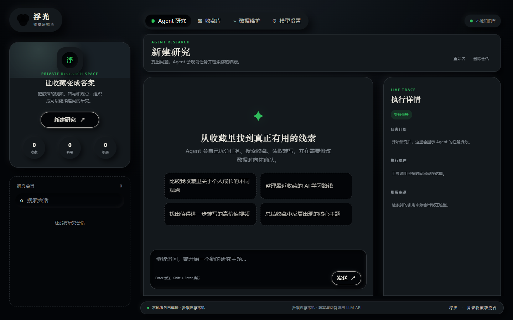
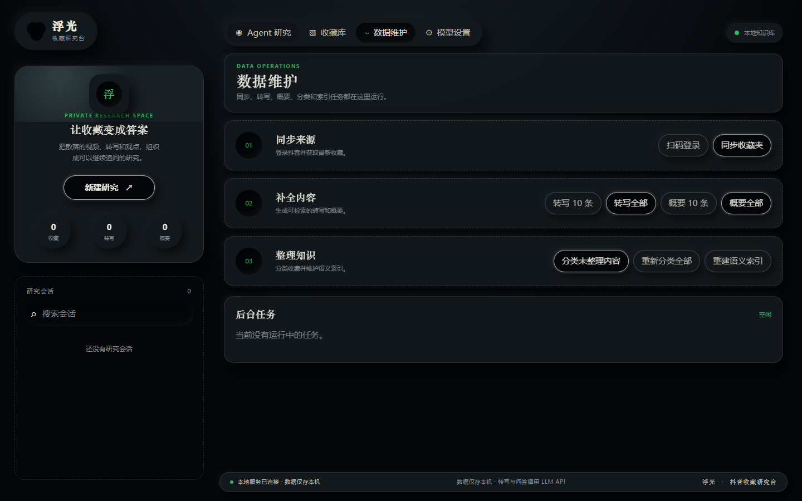
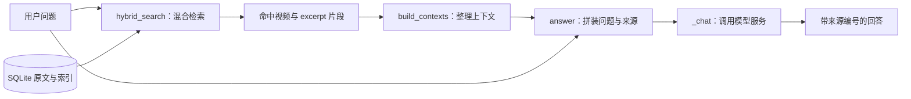
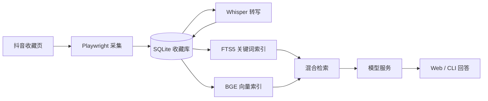

# 浮光 · 抖音收藏研究台

把抖音收藏整理成可搜索、可转写、可问答的个人知识库。应用在本地采集和保存收藏内容，使用本地模型完成语音转写与语义索引；概要、分类和问答通过用户配置的 OpenAI Chat Completions 兼容服务完成。

> **状态**：个人项目，功能完整，自用中。
> **技术栈**：Python 3.10+ · FastAPI · Playwright · SQLite（FTS5）· faster-whisper · BGE（ONNX int8）· 原生 HTML/CSS/JS
> **看点**：本地优先 / 私有部署 · 混合检索（FTS5 + 向量 + RRF 融合）· Agent 工具调用 + 人工审批 + 会话恢复 · 带来源引用的回答

## 功能

- **收藏同步**：扫码登录后采集标题、作者、标签和链接，重复同步时按视频 ID 增量入库。
- **搜索与整理**：搜索标题、标签、作者和转写文本；按 AI 生成的类别筛选收藏。
- **本地转写**：需要时下载音频，使用 faster-whisper 转写，文本保存到 SQLite。
- **检索问答**：结合 FTS5 关键词检索与本地 BGE 语义检索，按相关片段生成带来源的回答。
- **Agent 研究**：拆分研究任务，逐步搜索、读取和比较收藏；转写、概要等写入操作需在页面批准。研究会话、执行记录和引用可恢复。
- **模型池**：在 Web 页面配置多个模型服务，按优先级和权重路由，请求失败时切换可用配置。

## Web 界面

截图使用空白示例数据库，不包含个人收藏、登录态或 API Key。

| Agent 研究 | 数据维护 |
| --- | --- |
|  |  |

界面另有「收藏库」和「模型设置」。

## 快速开始

需要 **Python 3.10+**。Windows 用户可直接运行 `start.bat`。脚本会创建虚拟环境、安装依赖和 Chromium、下载 Whisper 与 BGE 模型，然后启动 `http://127.0.0.1:8642`。模型首次下载需要联网。

手动安装：

```powershell
python -m venv .venv
.\.venv\Scripts\Activate.ps1
python -m pip install -r requirements.txt
python -m playwright install chromium
python scripts/download_model.py small
python scripts/download_model.py bge
python main.py web
```

macOS/Linux 使用 `source .venv/bin/activate` 激活虚拟环境。BGE 缺失时，问答会退回关键词检索；Whisper 模型用于本地转写。

首次使用时，在「数据维护」扫码登录并同步收藏。随后可在「收藏库」搜索和转写视频；需要概要、分类或 Agent 研究时，先到「模型设置」添加并测试模型服务。

## 模型配置

Web 模型配置保存在当前浏览器的 `localStorage`。发起任务时，配置随请求提交给本地服务，由本地服务调用所选模型提供方。共享设备使用完毕后，可在「模型设置」清除浏览器配置。

CLI 的 `summarize` 和 `ask` 使用项目根目录的 `.env`。复制 `.env.example`，填写 `LLM_API_KEY`、`LLM_BASE_URL` 和 `LLM_MODEL`。Web 模型设置与 CLI `.env` 是两个独立的配置入口。

## 用了什么模型

项目使用现成模型推理，没有在仓库中实现模型训练或微调。三类模型分别负责听音频、找资料和组织答案：

| 任务 | 当前实现 / 默认配置 | 输入 → 输出 | 运行位置 |
| --- | --- | --- | --- |
| 语音转写 | faster-whisper，默认 `small`，`compute_type="int8"` | 视频音频 → 转写文本 | 本机，`device="auto"` |
| 语义检索 | `bge-small-zh-v1.5`，使用 Xenova 导出的 ONNX int8 权重 | 文本块 / 问题 → 512 维向量 | 本机 CPU |
| 概要、分类、问答、Agent 决策 | OpenAI Chat Completions 兼容接口；CLI 默认 `deepseek-chat`，Web 使用页面中选择的模型池 | 提示词与相关资料 → 文本或 JSON | 所配置的模型服务 |

`deepseek-chat` 是代码及 `.env.example` 的默认模型名，不代表所有运行都使用它，也不对应仓库锁定的底层权重版本。Web 实际使用哪个模型，取决于配置及路由结果。

BGE 的文档侧直接编码，查询侧加上指令前缀 `为这个句子生成表示以用于检索相关文章：`。向量归一化后，用 NumPy 内积计算相似度；向量和原文存入 SQLite。FTS5 同时负责关键词检索，两路结果用 **RRF（按排名融合）** 合并。

## Prompt 怎么设计

提示词按任务拆分；需要程序继续处理的结果要求 JSON，需要用户阅读的结果要求概要或带来源的回答。

| 任务与代码入口 | 提示词的关键约束 | 为什么这样设计 |
| --- | --- | --- |
| CLI 概要：`app/llm.py::summarize()`；Web：`app/web.py::summarize()` | 输入标题、作者及转写前 8000 个字符；输出 3–5 句话，不编造。CLI 还要求知识类视频列出要点 | 控制上下文长度，保留可快速阅读的重点；超出截断范围的内容不会被本次概要覆盖 |
| CLI 问答：`app/llm.py::answer()` | system 消息定义知识库助手、要求 `[来源N]` 引用及证据不足时说明；user 消息放问题和编号摘录 | 把回答与检索证据关联起来；优先使用命中片段，没有片段才退回转写前 3000 个字符 |
| 分类：`app/web.py::propose_categories()`、`_classify_batch()` | 抽样最多 100 条标题/标签提出 6–12 类，并包含“其他”；逐批输出 `{"视频id":"类别"}`，覆盖所有 ID，不自创类别 | 先统一类别，再映射视频；程序可校验遗漏 ID 和非法类别 |
| Agent：`app/agent/runtime.py::_system_prompt()` | 提供工具名、参数类型及副作用；一次输出一个 `plan`、`tool_call` 或 `final` JSON；资料不足先查工具，引用仅限真实返回的 ID | 让模型提出下一步，由程序校验、执行并回传结果；标题和转写明确作为数据处理 |

下面节选 CLI 问答的实际 system 提示词；Web 普通问答另有较短提示词，Agent 使用上表中的控制协议：

```text
你是用户的抖音收藏知识库助手。根据提供的视频内容摘录回答问题，
回答末尾用 [来源N] 标注引用了哪些视频。
如果摘录内容不足以回答，直接说明，不要编造。
```

提示词约束之外，程序还做结构和权限校验。Agent 用 Pydantic 校验决策及工具参数，转写、概要工具由运行时暂停并等待页面批准。提示词本身不能保证事实正确，也不能代替执行权限控制。

## 输入输出示例

以下均为**虚构资料和预期格式示意**，不是实际收藏、真实模型返回或质量评测。先假设收藏库中已有这条转写：

```text
视频 ID：demo-001
标题：用主动回忆复习
作者：示例作者
转写：先合上书，尝试回忆今天学过的内容。再翻书核对遗漏。
      第二天重新测试自己，优先复习答不出来的部分。
```

**概要输入**：上述标题、作者和转写。输出可能为：

```text
视频介绍了用主动回忆复习的方法。先合书回忆，再翻书核对遗漏。
第二天再次自测，并优先复习未掌握的内容。
- 合书回忆，再核对遗漏
- 次日自测，关注薄弱部分
```

**CLI 问答输入**（需要库中已有相关资料，并配置好 `.env`）：

```powershell
python main.py ask "收藏里提到怎样用主动回忆复习？"
```

检索层把上述视频的相关片段交给 `answer()`，回答格式可能为：

```text
先合上书回忆，再翻书核对遗漏；第二天重新自测，优先复习答不出来的部分。[来源1]
```

如果追问“每天必须复习多少分钟？”，这条资料没有时长信息，预期应说明资料不足。

**分类输出格式**：在候选类别包含“知识学习”和“其他”时，这条视频的映射可以是 `{"demo-001":"知识学习"}`。

**Agent 决策格式**：用户要求查找主动回忆资料时，模型建立计划后可以提出下列调用。它是交给程序执行的中间结果，页面最终展示研究答案及来源。

```json
{"type":"tool_call","tool":"search_semantic","args":{"question":"主动回忆复习"},"reason":"先查找相关收藏"}
```

### 跟着一次问答看数据流



这是 CLI 问答的核心路径。读代码时，`def answer(question: str, contexts: list[dict]) -> str` 表示定义函数：接收一个问题字符串和一组上下文字典，返回字符串；类型标注帮助阅读，本身不自动校验数据。`c.get("excerpt")` 从字典取片段，`transcript[:3000]` 取前 3000 个字符，`return _chat(...)` 则把模型调用的结果交回上层。

做改动前可以先问三个“为什么”：**为什么没找对资料？** 先检查转写和检索命中，再决定是否换模型；**为什么用片段而不是全文？** 节省上下文，但要检查分块是否丢失关联；**为什么分类要 JSON？** 因为结果需要写回数据库，必须先验证格式和 ID。

## 踩过的坑与处理方式

以下依据当前代码中的处理逻辑、修复注释及回归脚本整理；不把单次兼容处理当作所有服务的通用结论。

| 问题 | 当前处理 | 仍需注意 |
| --- | --- | --- |
| 接口兼容不等于参数完全一致；推理模型可能耗尽输出预算却没有正文 | Web 模型池识别推理模型、调整参数变体，检测空正文；路由回归见 `scripts/test_llm_router.py` | 具体行为依赖提供方；CLI 的 `app/llm.py` 使用较简单的调用封装，没有完整模型池降级逻辑 |
| 分类输出夹带思考文字、代码围栏，或遗漏视频 ID | 提取 JSON 并校验 ID；按 3000 / 6000 / 12000 的输出预算重试，后两次改非流式；最终失败的整批归入“其他”并记录降级，见 `scripts/test_classification.py` | 任务完成不代表每条都分类成功，需关注降级数量 |
| 只取转写开头，可能错过后半段的答案 | 转写按约 500 字分块、重叠约 60 字；混合检索优先把命中片段作为上下文 | 分块、召回和转写准确性仍影响答案；概要仍使用前 8000 个字符 |
| 下载失败占位文字会污染检索，还可能让视频被误认为已转写 | 下载失败不写占位转写，普通失败保留待重试；索引跳过以 `【` 开头的转写 | 登录失效要重新登录；跳过规则也可能排除恰好以该符号开头的真实文本 |
| 音频下载卡住或多个转写任务同时运行 | 下载设置超时和取消检查，转写使用进程内锁，见 `scripts/test_transcribe.py` | 锁的范围是当前进程，不能据此推断支持多服务进程并发转写 |
| 本地模型下载经镜像出现协议不兼容、空文件 | Whisper 优先加载项目内模型；设置 `HF_ENDPOINT`、禁用 Xet 后使用普通 HTTP 下载通道 | 环境变量要在相关库导入前设置；模型文件仍需成功下载 |
| Windows 默认控制台编码遇到 emoji 标题报错 | 转写模块尝试将标准输出设为 UTF-8，并替换无法编码的字符 | 日志显示问题不应让整批转写中断 |

## CLI

```text
python main.py login                  扫码登录
python main.py crawl                  同步收藏
python main.py search <关键词>         搜索收藏
python main.py transcribe [数量]       转写；--all 处理全部待转写视频
python main.py summarize [数量]        生成概要
python main.py index [--all]          增量构建或全量重建语义索引
python main.py ask <问题>              检索并回答
python main.py stats                  查看库内统计
python main.py web [--port 8642]      启动 Web 服务
```

## 技术架构



| 路径 | 职责 |
| --- | --- |
| `main.py` | CLI 入口 |
| `app/crawler.py`、`app/transcribe.py` | 收藏采集、音频下载和转写 |
| `app/db.py` | SQLite、FTS5、任务与会话持久化 |
| `app/indexer.py`、`app/embedder.py`、`app/retriever.py` | 文本分块、向量索引和混合检索 |
| `app/llm.py`、`app/llm_router.py` | CLI 模型调用与 Web 模型池 |
| `app/agent/` | Agent 工具和执行循环 |
| `app/web.py`、`static/` | FastAPI 服务和前端页面 |

## 数据与隐私

收藏、转写、概要、向量和研究会话保存在本机的 `data/`；`browser_data/` 保存登录态，`models/` 保存本地模型，`audio_cache/` 保存临时音频。这些目录及 `.env` 已加入 `.gitignore`。概要、分类和问答会向所选模型服务发送相关内容。

采集依赖抖音当前的页面结构和接口响应，平台调整后可能需要更新适配逻辑。请仅处理有权访问的内容，并遵守平台规则。

## 关于作者

北京在校的计算机专业学生（2028 届），方向是 Python 开发与 Linux 服务器运维。

除了这个项目，我还在维护一台腾讯云轻量服务器上的多个线上服务（域名解析、Nginx 反向代理、HTTPS 证书自动续期、CouchDB 后端），以及一套面向代码仓库的检索问答系统（AST 分块、三路召回融合、引用校验、Hit@K / MRR 评测）。

如果你需要类似的东西——文档 / 知识库问答、数据采集、服务器部署与排障——欢迎联系：**1077719239@qq.com**

> 本项目为个人自用工具，按原样提供；如需在商业场景使用其中代码，请先联系我。
